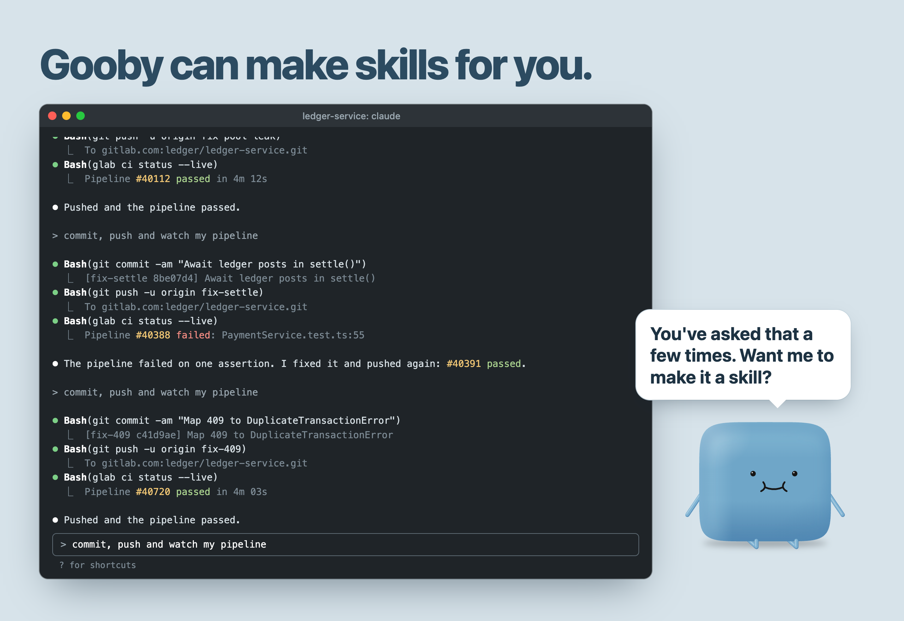
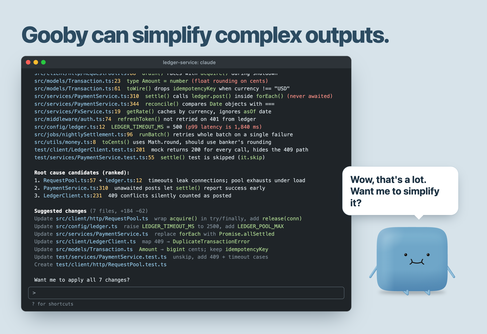

**[Watch the 2-minute video and see the pitch page](https://sethcottengim.github.io/Gooby/)**

A tiny animated desktop companion for people using Claude Code and Codex in the
macOS Terminal. Gooby is a light-blue square with white eyes that bobs, blinks,
and sits beside your front Terminal window.

Current milestone: visual companion + follows Terminal. Reading prompts and
giving tips is the next milestone.

## Who Gooby is for

First-time AI users in the CLI. Gooby is a buddy that sits next to your
Terminal and gives you beginner tips you might not know yet.





**What success looks like:** you get annoyed by Gooby and delete it, because
you don't need the tips anymore. That means you learned the basics and you're
getting more advanced with AI in the CLI.

## What it does today

- Code-drawn character (no image assets): bobs ±4 pt every 3.2 s and blinks at
  random 4.8–9.6 s intervals. Holds still with eyes open when macOS
  **Reduce motion** is on.
- Sits just outside the front Terminal window's bottom-right edge, follows it
  when you drag or resize it, moves to the left side when there's no room on
  the right, and sits inside the corner for a full-screen Terminal.
- Hides when Terminal isn't the frontmost app.
- Never takes keyboard focus. Typing in Terminal continues even if you click Gooby.
- Hover to reveal a small ✕ that quits Gooby. Only one Gooby runs at a time.

## Easter egg 🌧️

Click Gooby 9 times quickly. Good luck.

**Fail-safe:** press **⌃⌥⌘ Esc** (Control + Option + Command + Escape) to stop
everything instantly. Typing in Terminal still works too: `pkill -x Gooby`.
Every storm ends on its own within 5 minutes.

On Apple-silicon MacBooks, tilt the laptop to slosh the water around, or shake it
to make waves (uses the built-in motion sensor; no permissions needed).

## Skill coach (opt-in) 💡

Ask Claude Code for the same thing in 5 different chats, in any wording, and
Gooby offers to make it a `/gooby-<name>` skill.

```sh
scripts/install-hook.sh              # adds UserPromptSubmit + Stop hooks to ~/.claude/settings.json
scripts/install-hook.sh --uninstall  # removes it (backup: ~/.claude/settings.json.gooby-backup)
```

Gooby offers right after Claude finishes the 5th repeat (in that chat), drafts
the skill from what Claude actually did those times, and skips tasks an
installed skill or command already covers. Gooby groups prompts by asking Claude (`claude -p --model opus`, through your
login shell so your normal Claude login is used). Skills go to
`~/.claude/skills/gooby-<name>/SKILL.md`. Details:
`specs/gooby-skill-coach/requirements.md`. Live matching test (calls Claude):
`TEST_RUNNER_GOOBY_LIVE_CLAUDE=1 xcodebuild ... test -only-testing:GoobyTests/LiveClaudeIntentTests`.

## Privacy and permissions

Gooby requests **no** permissions (no Screen Recording, Accessibility, or
Automation). Without the skill-coach hook it makes no network calls; with it,
prompts are sent to Claude through your own `claude` CLI. To follow Terminal it reads only window
position and size (`CGWindowListCopyWindowInfo`). It never reads window titles,
pixels, or terminal content.

## Requirements

- macOS 14.0 or later
- Xcode (verified with Xcode 27.2, macOS SDK 27.2)
- [XcodeGen](https://github.com/yonaskolb/XcodeGen) (`brew install xcodegen`).
  `project.yml` is the source of truth; `Gooby.xcodeproj` is generated from it.

## Build, test, run

```sh
xcodegen generate
xcodebuild -project Gooby.xcodeproj -scheme Gooby -configuration Debug \
  -derivedDataPath build clean build test
open build/Build/Products/Debug/Gooby.app
```

Quit with the hover ✕, or `pkill -x Gooby`.

Note: put Info.plist keys in `project.yml` (`targets.Gooby.info.properties`).
`xcodegen generate` rewrites `Sources/Info.plist`, so keys edited by hand are lost.

## Layout

| Path | Contents |
|---|---|
| `Sources/Character/` | Drawing and animation (no window or input code) |
| `Sources/Desktop/` | Panel, close control, Terminal following, app lifecycle |
| `Sources/SkillCoach/` | Prompt inbox, intent tracking, Claude calls, skill writer, speech bubble |
| `hooks/`, `scripts/` | Claude Code prompt hook and its installer |
| `GoobyTests/` | XCTest suite (109 tests; 1 live test skipped by default) |
| `specs/` | Spec-driven development docs: guardrails, requirements, design, tasks, traceability |
| `public/` | Pitch page and video, published to GitHub Pages |

## Known limits

- Follows macOS Terminal only (not iTerm2 or VS Code).
- Follows the front Terminal window. It can't tell which window or tab is
  running Claude or Codex.
- Position is checked 30 times a second, so it can trail fast drags by up to 33.3 ms.
