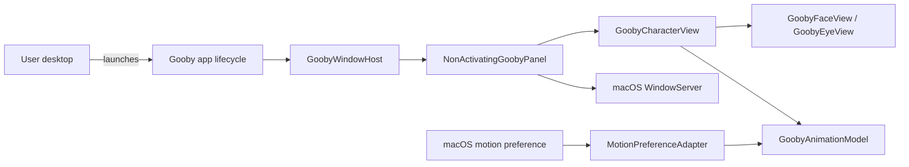
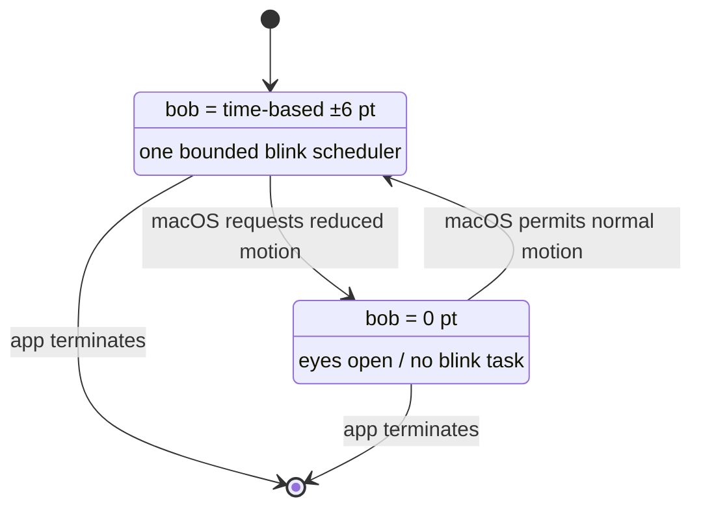
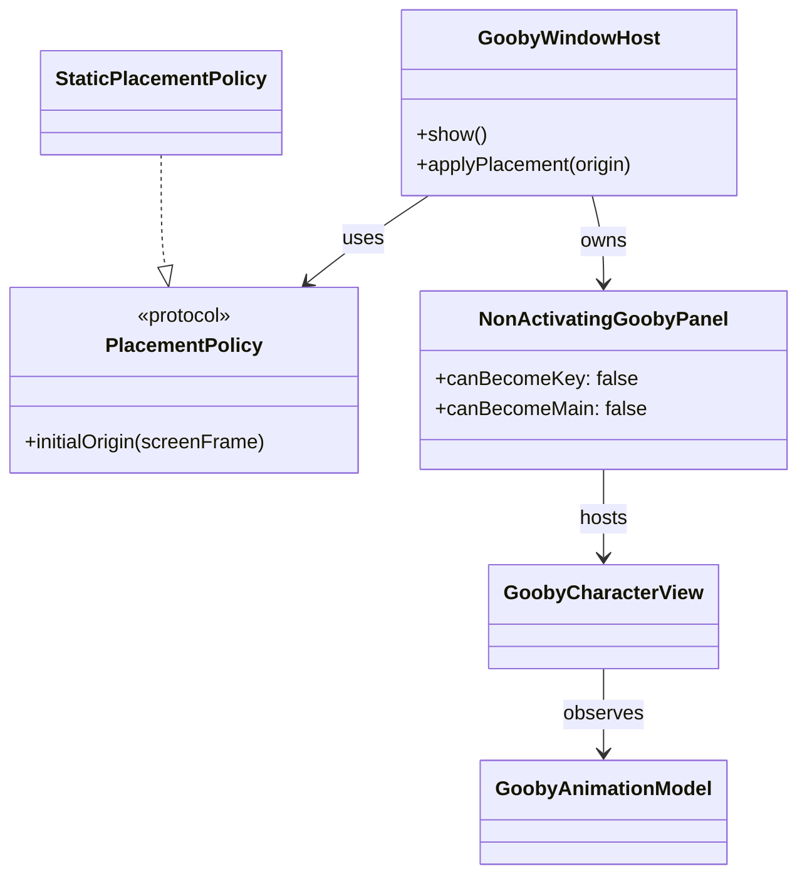
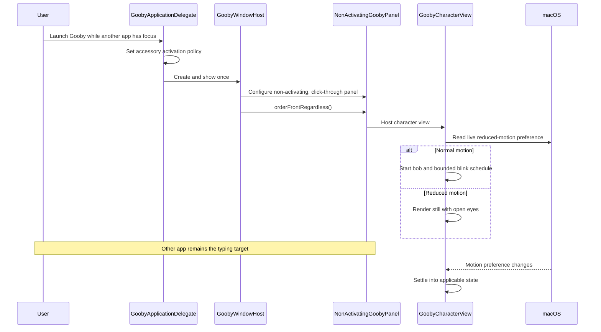
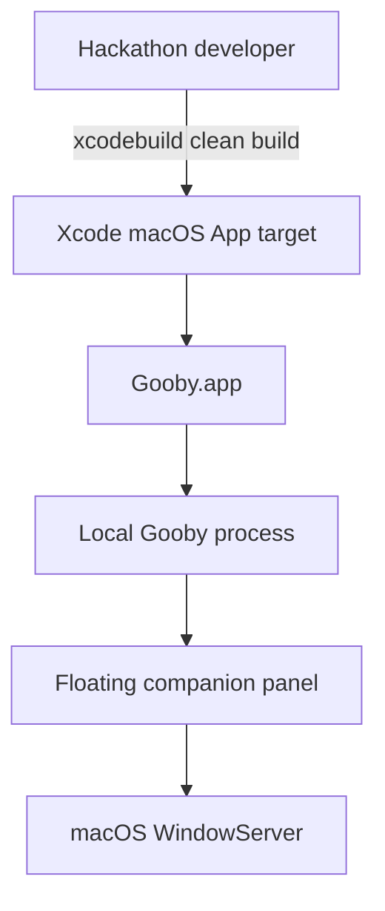
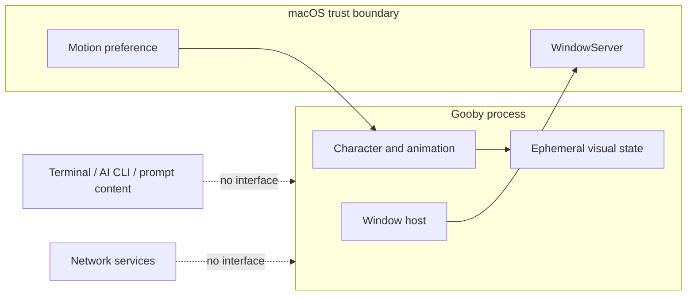

# System Design Spec: Gooby visual companion

## Document Information

| Field | Value |
|---|---|
| **Document ID** | SDS-UI-GOOBY-001 |
| **System/Feature** | Gooby visual companion baseline |
| **Version** | 1.0 |
| **Status** | Approved |
| **Owner** | Hackathon product owner |
| **Last Updated** | 2026-11-10 |
| **Related SRS** | `BSL-UI-GOOBY-001` — `specs/gooby/requirements.md` |
| **Applicable Guardrail Specs** | `specs/guardrails/gooby-visual-mvp.md` |
| **Design Constraints** | `DC-GOOBY-001` through `DC-GOOBY-005` |

## 1. Architecture Overview

### 1.1 High-Level Architecture

Gooby is a local-only macOS app. A small AppKit host owns a transparent,
non-activating panel. The panel hosts one SwiftUI character view. The character
owns its rendering and ambient animation state but has no reference to a
terminal, accessibility service, app focus, panel, network service, or stored
user data.



The panel frame is deliberately independent of character animation. Bobbing
changes only the character drawing offset inside a stable transparent canvas;
it never moves or resizes the native window.

### 1.2 Design Principles

| Principle | Rationale | Applicable Requirements |
|---|---|---|
| Character only | Gooby itself is the sole product surface; no dashboard, copy, badge, card, or decorative chrome competes with it. | BSL-GOOBY-001, BSL-GOOBY-002 |
| Native host, code-drawn face | AppKit provides native window behavior and SwiftUI draws every visible character element without raster assets or third-party animation packages. | BSL-GOOBY-001, BSL-GOOBY-002, BSL-GOOBY-008 |
| Focus preservation by construction | The host is non-activating and click-through, then is manually tested on the supported operating system before focus safety is claimed. | BSL-GOOBY-006, DC-GOOBY-001 |
| Motion is ambient, not structural | The panel remains fixed while a time-based transform moves the face smoothly within it. | BSL-GOOBY-003, BSL-GOOBY-005 |
| Clear extension boundary | Character rendering and animation do not know where the panel sits; later terminal tracking can change only the host placement policy. | CON-GOOBY-002, DC-GOOBY-003 |
| Ephemeral by default | Motion state exists only in memory. No prompt, terminal, user, or analytics data enters this baseline. | BSL-GOOBY-007 |

### 1.3 Key Design Decisions

| Decision | Options Considered | Choice | Rationale |
|---|---|---|---|
| Window host | SwiftUI `WindowGroup`; standard `NSWindow`; AppKit `NSPanel` | AppKit `NSPanel` subclass | `NSPanel` supports a non-activating, floating, transparent companion surface with direct focus controls. |
| App surface | Main window plus character; character-only panel | Character-only panel | It exactly matches the visual-MVP boundary and avoids accidental product chrome. |
| Rendering | Raster sprite; external animation package; SwiftUI shapes | SwiftUI vector shapes | Keeps the face crisp, dependency-free, and adjustable through named visual metrics. |
| Bobbing | Move native panel; implicit repeated animation; time-based drawing offset | Time-based SwiftUI drawing offset | Keeps panel placement stable and separates motion from future placement behavior. |
| Blink cadence | Fixed timer; bounded nonuniform schedule | Bounded randomized schedule | Looks less mechanical while guaranteeing the first blink occurs well inside the 30-second review. |
| Project scaffold | Swift package executable; Xcode macOS app target | Standard Xcode macOS app target | Produces a launchable `.app`, declares a deployment target, and has a reproducible native clean-build command. |

No implementation component exists in the workspace to reuse. The planned
types below are new, narrowly scoped types rather than replacements for an
existing UI or desktop-integration component.

## 2. Component Design

### 2.1 Platform and Build Boundary

| Aspect | Decision |
|---|---|
| Supported deployment target | macOS 14.0 or later |
| Implementation language | Swift |
| UI technologies | SwiftUI for drawing and state; AppKit for the companion panel and lifecycle integration |
| Project form | One standard Xcode macOS App target named `Gooby` |
| Runtime dependencies | Apple frameworks only: SwiftUI, AppKit, and Foundation. No Swift Package Manager packages, character images, or animation libraries. |
| Clean-build command | `xcodebuild -project Gooby.xcodeproj -scheme Gooby -configuration Debug clean build` |

macOS 14.0 is the supported floor because the selected AppKit panel APIs and
SwiftUI `accessibilityReduceMotion` environment input compile against that
target in the local toolchain. A successful build with a newer SDK does not by
itself prove the supported-floor behavior; manual normal-motion,
reduced-motion, and focus checks remain required on macOS 14.0 or later.

### 2.2 Planned Source Boundaries

| Planned Type / File | Responsibility | Must Not Know About |
|---|---|---|
| `GoobyApp` | SwiftUI application entry point and app-delegate attachment. | Terminal state, character geometry, animation timing. |
| `GoobyApplicationDelegate` | Sets accessory activation policy, creates the host after launch, and releases it during termination. | Face drawing or blink timing. |
| `GoobyWindowHost` | Creates, places, shows, and later may reposition the panel. | How Gooby is drawn or animated. |
| `NonActivatingGoobyPanel` | AppKit panel subclass that cannot become key or main. | Terminal tracking, prompts, or user content. |
| `StaticPlacementPolicy` | Calculates an initial visible screen position with a centered fallback. | Terminal windows or accessibility APIs. |
| `GoobyCharacterView` | Composes the body and face and applies the bobbing offset. | AppKit panel ownership or window activation. |
| `GoobyFaceView` and `GoobyEyeView` | Draw the white eyes, black pupils, and eye-closure mask. | Panel placement and system permissions. |
| `GoobyVisualMetrics` | Holds named sizes, colors, spacing, and motion constants. | Runtime app lifecycle. |
| `GoobyAnimationModel` | Holds the in-memory blink state and bounded interval scheduling. | AppKit panel or terminal state. |
| `MotionPreferenceAdapter` | Receives the live SwiftUI motion-preference value and changes animation mode. | Window placement and persistent storage. |

The expected project layout after implementation is:

```text
Gooby.xcodeproj/
Sources/
  GoobyApp.swift
  Desktop/
    GoobyApplicationDelegate.swift
    GoobyWindowHost.swift
    NonActivatingGoobyPanel.swift
    StaticPlacementPolicy.swift
  Character/
    GoobyCharacterView.swift
    GoobyFaceView.swift
    GoobyEyeView.swift
    GoobyVisualMetrics.swift
    GoobyAnimationModel.swift
    MotionPreferenceAdapter.swift
GoobyTests/
```

### 2.3 Character Rendering and Visual Tokens

The transparent panel contains a 136 × 136 point canvas. A centered 112 × 112
point body has 12 points of vertical clearance above and below it, enough for a
6-point upward or downward bob without clipping.

| Token | Value | Use |
|---|---:|---|
| `bodySize` | 112 × 112 pt | Light-blue square body |
| `bodyCornerRadius` | 28 pt | Soft, friendly corners |
| `bodyFill` | `#89CBEA` | Solid body color; no gradient |
| `bodyOutline` | `#2C4B61`, 3 pt | Restrained dark outline |
| `eyeFill` | `#FFFFFF` | Two vertical capsule eyes |
| `eyeSize` | 26 × 34 pt | Open-eye geometry |
| `pupilFill` | `#12181D` | Black pupils |
| `pupilSize` | 12 × 16 pt | Slightly low-centered, attentive pupils |
| `bobAmplitude` | ±6 pt | 12-point peak-to-peak vertical travel |
| `bobPeriod` | 3.2 s | One smooth full bob cycle |
| `blinkInterval` | 4.8–9.6 s | Bounded, nonuniform time between blink starts |
| `blinkClose` / `hold` / `open` | 0.090 s / 0.050 s / 0.140 s | Calm eye-close sequence |

`GoobyCharacterView` uses a solid `RoundedRectangle` with an outline and two
`GoobyEyeView` instances. It contains no text, mouth, blush, cheeks, badges,
shadows, panels, gradients, or images. The eyes are clipped by an openness mask
during a blink; pupils are visible whenever the eyes are open and fully hidden
only during the closed interval.

The visual plan intentionally spends its boldness on a single small animated
character. It rejects the common dashboard, card-stack, gradient, and
onboarding styling that would make the companion feel like generic software
rather than a calm desktop creature.

#### 2.3a Character v2 amendment (2026-11-10)

Replaces the v1 tokens above. All values were measured from the product owner's
reference image (2400 × 1792 px; body box 980 × 891 px) and checked with a
same-scale side-by-side render.

- Canvas 160 × 144 pt. Body 106 × 96 pt (aspect 1.106), a superellipse "pillow"
  (exponent 5.5 top half, 6.5 bottom half so it sits flat), centered 6 pt above
  canvas center.
- Palette (5 × 5 body grid): interior `#6FA6C8`, top band `#85BAD5`, lit left edge
  `#94C3DC`, underside `#568CB5`, darkest bottom-right `#5188B3`; limbs `#7FB3D3` /
  `#5A90BA`; features `#161616`.
- Shading: top→bottom gradient, left-edge light falloff (25% of width), bottom-right
  shade, top-left corner sheen, soft inner rim.
- Face centered at 56.7% of body width (the reference is turned slightly):
  4.3 × 4.4 pt glossy dot eyes at 43.2% height, ±15.8% apart (blink squashes to 14%
  height); a 14.6 pt smile at 54.6% height (1.6 pt sag, 1.4 pt line) whose ends cross
  ")" / "(" ticks rising 4.1 pt and dropping 3.2 pt, kicking 3 pt outward. No
  cheeks: the face area stays flat (product owner, 2026-11-10).
- Limbs 3.4 pt: arms (behind) attach at 57% height, reaching 9.5 pt out and 20 pt
  down; legs slant from under the body (drawn behind it) 6.7 pt across and 6.1 pt
  down to heels 4.6 pt below the body at 43.5% / 73.8% width; 5 pt feet point
  straight up from each heel in front of the body (shorter than the reference's
  ~9 pt so leg and foot read distinctly).
- Tight contact shadow 100 × 6 pt at 28% opacity just under the body; it shrinks
  and fades slightly as Gooby bobs upward.
- Views: `GoobyFigureView`, `GoobyFaceView`, `GoobyBodyShape`, `GoobyEyeView`,
  `GoobySmileShape`, `GoobyGroundShadow`. Motion tokens unchanged except bob
  amplitude, reduced from ±6 pt to ±4 pt (8 pt peak-to-peak) on 2026-11-11 at
  product-owner request.
- Display scale 0.7 (2026-11-11, product owner: "30% smaller"): all geometry above is
  in design points inside the 160 × 144 canvas and is drawn scaled by 0.7 into a
  112 × 102 pt on-screen panel (rounded up to even points so placement stays on whole
  points). On screen the body is 74.2 × 67.2 pt and the bob is ±2.8 pt. The hover close
  control is 15 pt.

### 2.4 Animation and Motion Preference

In normal motion, `GoobyCharacterView` derives its vertical offset from elapsed
time using a sine curve {sinusoidal interpolation}. The curve has no bounce,
stops cleanly at zero when motion is reduced, and cannot resize or reposition
the panel.

`GoobyAnimationModel`, isolated to the main UI thread, samples the next blink
interval from the inclusive 4.8–9.6 second range. It runs exactly one
cancellable scheduling task while normal motion is enabled. A blink closes the
eye aperture over 0.090 seconds, holds it for 0.050 seconds, then reopens it
over 0.140 seconds. The first scheduled blink is always no later than 9.6
seconds after normal motion begins, satisfying the 30-second visual review
without using a robotic fixed timer.

`MotionPreferenceAdapter` reads `@Environment(\.accessibilityReduceMotion)`
as a live input. When the preference changes to reduced motion it cancels the
blink task, immediately resets both eyes to fully open without an additional
animation, and renders a zero vertical offset. When normal motion returns, it
starts a fresh bounded blink interval and resumes the time-based bob. This
covers a preference change while the panel is already visible.



### 2.5 Non-Activating Companion Host

`GoobyWindowHost` builds one `NonActivatingGoobyPanel` with a clear background,
no shadow, and a 136 × 136 point content area. It uses a static initial screen
placement in the visible screen frame; if macOS cannot identify a usable
screen, it falls back to a centered placement. It performs no terminal lookup
and does not persist a location.

The panel is configured as follows:

| Control | Configuration | Why it matters |
|---|---|---|
| Style | `.borderless` and `.nonactivatingPanel` | The companion has no window chrome and does not activate its owning app. |
| Key/main eligibility | Override `canBecomeKey` and `canBecomeMain` to return `false` | Gooby cannot become the keyboard or main window. |
| Input | `ignoresMouseEvents = false`; `GoobyHostingView` accepts first mouse and tracks hover with an `.activeAlways` tracking area | Required for the hover-revealed close circle (amendment 2026-11-10). Fully transparent canvas pixels still pass clicks through. The panel still cannot become key, so focus stays in the other app. |
| Visibility | `.floating` level and `orderFrontRegardless()` | Keeps Gooby visible without making it key or main. |
| App activation | `.accessory` policy at launch plus `LSUIElement = YES` | Prevents ordinary Dock/menu-bar activation behavior from becoming part of the companion experience. |
| Prohibited calls | Never call `activate`, `makeKeyAndOrderFront`, `makeKeyWindow`, or `makeMainWindow` | Prevents accidental focus transfer in this baseline. |

The combination is stronger than any single control, but it is not treated as a
proof of focus preservation. Manual verification must launch Gooby while a
different app is already accepting keyboard input, confirm uninterrupted typing
there, and repeat after clicking the visible character. If the supported macOS
configuration does not meet that test, BSL-GOOBY-006 remains unmet and the MVP
must not claim focus-safe behavior.

Amendment 2026-11-10: the only control is `GoobyCloseButton`, an 18 pt
code-drawn circle (`#2C4B61` fill, white X) fixed at the canvas top-right. It
fades in over 0.15 s while hovered (no fade under reduced motion), does not bob,
and calls `NSApplication.terminate`. It lives in `Desktop/` inside
`GoobyRootView`, so the character views remain control-free (DC-GOOBY-003).
`GoobyApplicationDelegate` quits a newly launched Gooby when an earlier instance
with the same bundle ID is running (ties broken by lower process ID; skipped
when running as the XCTest host). Gooby still cannot be dragged or used for a
“Paste into terminal” action.
Those future interaction requirements require a new design pass because they
must preserve user review and keyboard safety without weakening the focus rule.

### 2.6 Future Placement Extension

The current host accepts a `StaticPlacementPolicy`. A later desktop-integration
feature may replace it with a terminal-relative policy that produces a new
panel origin. The host will apply that origin while the character remains the
same SwiftUI view and retains the same animation model. No terminal access,
screen observation, prompt analysis, or text insertion is designed or enabled
in this baseline.



## 3. Interface Design

### 3.1 External Interfaces

| Interface ID | System | Direction | Data / Control | Auth / Permission | SRS Requirement |
|---|---|---|---|---|---|
| IF-GOOBY-001 | macOS WindowServer | Outbound | Creates and orders one transparent, non-activating panel | None; no privileged desktop API | BSL-GOOBY-001, BSL-GOOBY-006 |
| IF-GOOBY-002 | macOS accessibility motion preference | Inbound | Boolean reduced-motion preference exposed through SwiftUI | None | BSL-GOOBY-005 |
| IF-GOOBY-003 | Xcode build system | Development only | Produces a local macOS app artifact | Local developer environment | BSL-GOOBY-008 |

There is no terminal, Claude Code, Codex, network, prompt, screen capture,
Accessibility, Automation, storage, or analytics interface in this baseline.

### 3.2 Internal Interfaces

| Interface ID | From | To | Contract | Purpose |
|---|---|---|---|---|
| IF-GOOBY-INT-001 | `GoobyApplicationDelegate` | `GoobyWindowHost` | Create once, `show()` once at launch, release at termination | Keeps lifecycle separate from hosting. |
| IF-GOOBY-INT-002 | `GoobyWindowHost` | `PlacementPolicy` | Screen visible frame in; initial origin out | Allows future terminal-relative placement without changing the character. |
| IF-GOOBY-INT-003 | `GoobyWindowHost` | `NonActivatingGoobyPanel` | SwiftUI root view and placement supplied by host | Keeps AppKit focus policy outside SwiftUI drawing. |
| IF-GOOBY-INT-004 | `MotionPreferenceAdapter` | `GoobyAnimationModel` | `normal` or `reduced` motion mode | Starts or cancels ambient animation safely. |
| IF-GOOBY-INT-005 | `GoobyCharacterView` | `GoobyAnimationModel` | Read-only bob offset and eye openness | Draws current state without knowing scheduling details. |

### 3.3 Critical Flows



## 4. Data Design

This baseline has no persistent data model, database, file store, user
preferences, prompt content, terminal content, or telemetry. An entity
relationship diagram is therefore not applicable.

| In-Memory Value | Lifetime | Storage | Purpose |
|---|---|---|---|
| Current motion mode | While app runs | `GoobyAnimationModel` | Chooses normal or reduced rendering. |
| Eye openness | While app runs | `GoobyAnimationModel` | Draws blinking eyes. |
| Blink task and next interval | While normal motion runs | `GoobyAnimationModel` | Schedules the next bounded blink. |
| Visual metrics | Process lifetime | Immutable code constants | Keeps face proportions and colors consistent. |
| Current panel origin | While app runs | `GoobyWindowHost` / AppKit | Positions the panel on the visible screen. |

All runtime state is discarded on termination. The app must not write user
content or motion state to disk.

## 5. Deployment Design

### 5.1 Local Demonstration Topology



The visual MVP has one local environment: a supported macOS 14.0-or-later
machine. It has no server, production deployment, secrets, network endpoint,
or database.

### 5.2 Build and Recovery

| Aspect | Design |
|---|---|
| Build | Standard Xcode macOS app target; clean-build command in §2.1. |
| Artifact | Local `Gooby.app` in Xcode build output. |
| Rollback | Rebuild or relaunch the prior local source revision; no deployed service or persisted schema exists. |
| Failure recovery | App termination cancels the blink task and releases the panel; a relaunch recreates only in-memory visual state. |
| Unsupported OS | The declared deployment target prevents claiming support below macOS 14.0. A build on a newer SDK does not substitute for the supported-floor manual checks. |

## 6. Security, Privacy, and Trust Boundary Design

The only trusted local inputs are app launch and the operating system’s motion
preference. The app intentionally has no user-content input channel. It must
not call Accessibility, Apple Events / Automation, screen-recording, terminal,
or network APIs, and it must declare no related permission usage.



| Control | Design |
|---|---|
| Permission minimization | Use only standard AppKit and SwiftUI window and preference APIs; do not request Accessibility, Automation, screen-recording, or terminal permission. |
| Content minimization | Do not read, transmit, log, or persist terminal, prompt, or user content. |
| Input safety | Make the panel click-through and non-key/non-main so it cannot intercept typing. |
| Dependency minimization | Use Apple frameworks only; no third-party character, image, or animation library. |
| Evidence boundary | Inspection verifies permissions and dependency manifest; manual testing verifies actual focus behavior. |

## 7. Portability and Recovery

Portability is intentionally limited to supported macOS systems. It is not a
cross-platform product in this milestone. The source and Xcode project are
sufficient to reproduce the app because there is no remote state, user data,
or external runtime dependency. There is no backup or data-recovery design to
operate because Gooby stores no data.

## 8. Design Constraint Coverage

| DC ID | Constraint Description | How Addressed | Section |
|---|---|---|---|
| DC-GOOBY-001 | Preserve the previously active app as the keyboard target and manually verify it. | `NSPanel` uses `.nonactivatingPanel`, cannot become key/main, ignores mouse events, uses `orderFrontRegardless()`, and avoids activation calls. The manual acceptance check remains mandatory. | §2.5, §3.3, §6 |
| DC-GOOBY-002 | Declare a supported macOS target and verify compatible motion APIs. | The Xcode app target supports macOS 14.0+ and uses SwiftUI `accessibilityReduceMotion`, with manual checks on that floor or later. | §2.1, §2.4, §5.2 |
| DC-GOOBY-003 | Separate character rendering and animation from native window hosting. | AppKit host/panel and placement policy have no drawing responsibilities; SwiftUI character and animation model have no AppKit placement reference. | §1.1, §2.2, §2.6, §3.2 |
| DC-GOOBY-004 | Use focused, semantic SwiftUI/AppKit types. | Each planned type has one named responsibility and the file plan maps one responsibility to one focused implementation unit. | §2.2 |
| DC-GOOBY-005 | Use bounded, nonuniform blink intervals in normal motion. | One cancellable scheduler samples 4.8–9.6 second intervals; reduced motion cancels it and resets the eyes open. | §2.4 |

## 9. Design-to-Requirement Traceability

| SRS Req ID | Requirement (Brief) | Design Sections | Design Approach |
|---|---|---|---|
| BSL-GOOBY-001 | Launch one separate native Gooby window. | §1.1, §2.1, §2.5, §5 | One AppKit panel hosts one SwiftUI character. |
| BSL-GOOBY-002 | Draw the specified blue square, eyes, and pupils with prohibited details absent. | §2.3 | Named code-drawn vector metrics and explicit visual exclusions. |
| BSL-GOOBY-003 | Smooth, gentle vertical motion. | §1.1, §2.4 | Time-based ±6-point sine offset in a stable canvas. |
| BSL-GOOBY-004 | Occasional blink while normal motion is enabled. | §2.4 | One bounded, nonuniform scheduler with eye-aperture animation. |
| BSL-GOOBY-005 | Honor reduced motion. | §2.1, §2.4, §3.3 | Live preference adapter cancels motion and renders eyes open. |
| BSL-GOOBY-006 | Do not take keyboard focus from another application. | §1.2, §2.5, §3.3, §6 | Layered non-activation configuration plus mandatory manual focus test. |
| BSL-GOOBY-007 | Collect no user content and request no privileged desktop or terminal permission. | §3.1, §4, §6 | No content interface, store, permission request, or external service. |
| BSL-GOOBY-008 | Complete a clean native build without character or animation dependencies. | §2.1, §5.1, §5.2 | Standard Xcode app target with Apple frameworks only and an explicit clean-build command. |

## Appendix A: Glossary

| Term | Definition |
|---|---|
| Non-activating panel | An AppKit panel configured to appear without making its owning application the active typing target. |
| Click-through | A window setting that passes mouse events to whatever is underneath the panel. |
| Reduced motion | A macOS accessibility preference requesting that automatic motion be minimized. |
| Static placement policy | The visual MVP’s screen-relative placement strategy; it has no terminal awareness. |

## Appendix B: Revision History

| Version | Date | Author | Changes |
|---|---|---|---|
| 1.0 | 2026-11-10 | Codex with product-owner input | Initial visual-MVP system design. |
| 1.1 | 2026-11-10 | Codex with product-owner input | User approved the visual-MVP design. |
| 1.2 | 2026-11-10 | Codex with product-owner input | User accepted the F-5A-001 toolchain-provenance remediation. |

## Appendix C: Design Adversarial Analysis

| ID | Sev | Category | Title | Resolution | Status |
|---|---|---|---|---|---|
| F-5A-001 | Medium | Supply chain | Native toolchain provenance is not captured with clean-build evidence. | `TASK-GOOBY-REMEDIATE-F-5A-001` scheduled in Task Group 1. | Resolved through planned remediation |

