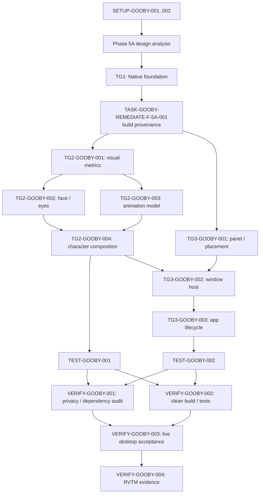

# Task List: Gooby visual companion

## Document Information

| Field | Value |
|---|---|
| **Document ID** | TL-UI-GOOBY-001 |
| **System/Feature** | Gooby visual companion baseline |
| **Version** | 1.0 |
| **Status** | Approved |
| **Owner** | Hackathon product owner |
| **Last Updated** | 2026-11-10 |
| **Mode** | Baseline implementation |
| **Requirement Spec Ref** | `specs/gooby/requirements.md` — BSL-UI-GOOBY-001 |
| **Design Spec Ref** | `specs/gooby/design.md` — SDS-UI-GOOBY-001 |
| **Guardrail Spec Ref** | `specs/guardrails/gooby-visual-mvp.md` |

## AI Assistant Instructions

1. Read the approved guardrail, requirements, design, and this task list before
   starting work.
2. Complete Phase 5A and add every resulting Critical or High remediation task
   before implementation begins.
3. Keep Gooby visual-only. Do not add terminal tracking, prompt access, text
   insertion, network access, speech, interaction controls, or product chrome.
4. Use only the Apple frameworks named in the design. No character image,
   external animation package, or third-party package may be added.
5. Work serial dependency chains in order; run independent files in parallel.
6. Use test-first implementation where a pure calculation or state transition
   can be isolated. Update the RVTM only after its evidence passes.
7. Do not claim BSL-GOOBY-006 satisfied from a unit test. Run the required
   logged-in macOS desktop focus test.
8. This workspace had no Git repository when this plan was written. (2026-11-10: the product owner approved a Git repository for Gooby.) Do not
   initialize or alter source-control configuration without a separate user
   decision. Record build/test evidence in the RVTM instead of referring to a
   commit.

## 1. Prerequisites and Setup

- [x] **SETUP-GOOBY-001** — Record reproducible verification commands and the
  manual acceptance script.
  - Build: `xcodebuild -project Gooby.xcodeproj -scheme Gooby -configuration Debug clean build`
  - Tests: `xcodebuild -project Gooby.xcodeproj -scheme Gooby -configuration Debug test`
  - Artifact inspection: resolve the built `Gooby.app` path, then run
    `codesign -d --entitlements :- <Gooby.app>` and
    `plutil -p <Gooby.app>/Contents/Info.plist`.
  - Test report: Xcode `.xcresult` output; Phase 6B stores round evidence under
    `.sdd/converge/round-<n>/`.
  - Manual script: use TG4-GOOBY-003 exactly, including a focused-Terminal
    sentinel-string test before and after clicking Gooby.
  - Base: unavailable — the workspace is not a Git repository.
  - Dependencies: none.

- [x] **SETUP-GOOBY-002** — Re-read and confirm the approved scope before code
  exists.
  - Required inputs: guardrail, BSL-GOOBY-001 through BSL-GOOBY-008, all five
    DC-GOOBY constraints, and the design constraint coverage table.
  - Confirm the visual exclusions: no blush, cheeks, mouth, text, badges,
    gradients, shadows, dashboard, onboarding, or extra character.
  - Confirm that privilege requests, terminal access, prompt access, storage,
    network access, and user-content collection remain out of scope.
  - Dependencies: none.

### 1.5 Design Adversarial Analysis

Phase 5A is complete. It found no Critical or High issue. Its one Medium
reproducibility finding is resolved through the approved remediation task
below. No implementation task may start until every Critical or High finding
has a mapped remediation task.

#### 1.5.1 Findings

| Finding ID | Category | Source Spec(s) | Description | Severity | Affected Requirement(s) | Remediation Task |
|---|---|---|---|---|---|---|
| F-5A-001 | Supply chain | `specs/gooby/design.md` §2.1; `specs/gooby/tasks.md` §1 | Clean-build evidence does not capture exact Xcode, SDK, or deployment-target provenance. | Medium | BSL-GOOBY-008, DC-GOOBY-002 | Proposed `TASK-GOOBY-REMEDIATE-F-5A-001` |

#### 1.5.2 Remediation Tasks

| Task ID | Finding(s) | Task Description | Insert Into | Priority | Dependencies | Status |
|---|---|---|---|---|---|---|
| TASK-GOOBY-REMEDIATE-F-5A-001 | F-5A-001 | Record `xcodebuild` version, resolved SDK version, and macOS deployment target with each clean-build evidence bundle. | Task Group 1 | Medium | TG1-GOOBY-003 | Approved and scheduled |

#### 1.5.3 Summary

| Severity | Count | Addressed | Remaining |
|---|---:|---:|---:|
| Critical | 0 | 0 | 0 |
| High | 0 | 0 | 0 |
| Medium | 1 | 1 | 0 |
| Low | 0 | 0 | 0 |
| **Total** | **1** | **1** | **0** |

## 2. Task Groups

### Task Group 1: Native Project Foundation

**Requirements covered:** BSL-GOOBY-001, BSL-GOOBY-008, DC-GOOBY-002  
**Execution:** Serial  
**Agent assignment:** Primary implementation agent

| Task ID | Task | Requirement(s) | Serial / Parallel | Dependencies | Files | Status |
|---|---|---|---|---|---|---|
| TG1-GOOBY-001 | Create a standard Xcode macOS App project named Gooby with a macOS 14.0 deployment target, one app target, one XCTest target, and no package dependencies. Avoid a SwiftUI `WindowGroup` main surface; the app delegate will own the companion panel. | BSL-GOOBY-001, BSL-GOOBY-008, DC-GOOBY-002 | Serial | SETUP-GOOBY-001, SETUP-GOOBY-002, Phase 5A | `project.yml`, `Gooby.xcodeproj/`, `Sources/Info.plist`, `Sources/GoobyApp.swift`, `GoobyTests/` | ✅ |
| TG1-GOOBY-002 | Establish semantic source folders and build configuration: `Desktop/`, `Character/`, `GoobyApp.swift`, and an Info property with `LSUIElement = YES`. Keep the app icon, if the Xcode template creates one, distinct from the prohibited character raster asset. | BSL-GOOBY-001, BSL-GOOBY-002, BSL-GOOBY-008, DC-GOOBY-004 | Serial | TG1-GOOBY-001 | `Sources/GoobyApp.swift`, `Sources/Desktop/`, `Sources/Character/`, `Sources/Info.plist` | ✅ |
| TG1-GOOBY-003 | Prove the scaffold has one launchable app target and a discoverable test target using the build and test commands from SETUP-GOOBY-001. Do not introduce external packages or character assets to make the scaffold compile. | BSL-GOOBY-008 | Serial | TG1-GOOBY-002 | `Gooby.xcodeproj/`, `GoobyTests/` | ✅ |
| TASK-GOOBY-REMEDIATE-F-5A-001 | Capture `xcodebuild -version`, `xcrun --sdk macosx --show-sdk-version`, and the resolved `MACOSX_DEPLOYMENT_TARGET` from build settings with the first clean-build evidence bundle. Make the same provenance capture part of every later clean-build verification. | BSL-GOOBY-008, DC-GOOBY-002 | Serial | TG1-GOOBY-003 | `.sdd/converge/` (generated evidence only), `specs/gooby/tasks.md` | ✅ |

**Task Group 1 gate:** clean native build succeeds; the XCTest target runs; the
project dependency and asset inventory shows no external character or animation
dependency; the evidence bundle includes Xcode, SDK, and deployment-target
provenance.

### Task Group 2: Character Rendering and Ambient Motion

**Requirements covered:** BSL-GOOBY-002, BSL-GOOBY-003, BSL-GOOBY-004,
BSL-GOOBY-005, DC-GOOBY-004, DC-GOOBY-005  
**Execution:** Mixed — visual metrics establish the shared contract, then the
face and motion-model streams can run in parallel  
**Agent assignment:** Two implementation agents, then one integration agent

| Task ID | Task | Requirement(s) | Serial / Parallel | Dependencies | Files | Status |
|---|---|---|---|---|---|---|
| TG2-GOOBY-001 | Define immutable `GoobyVisualMetrics` as the shared contract for exact body, face, color, and motion constants. Keep it pure and dependency-free so it can be tested before drawing or scheduling exists. | BSL-GOOBY-002, BSL-GOOBY-003, BSL-GOOBY-004, BSL-GOOBY-005, DC-GOOBY-004, DC-GOOBY-005 | Serial | TASK-GOOBY-REMEDIATE-F-5A-001 | `Sources/Character/GoobyVisualMetrics.swift` | ✅ |
| TG2-GOOBY-002 | Implement code-drawn `GoobyFaceView` and `GoobyEyeView` using the shared metrics. Render exactly one 112 × 112 pt light-blue rounded square with a 28 pt corner radius, 3 pt dark outline, white eyes, and black pupils. Exclude every prohibited visual detail. | BSL-GOOBY-002, DC-GOOBY-004 | Parallel with TG2-GOOBY-003 | TG2-GOOBY-001 | `Sources/Character/GoobyFaceView.swift`, `Sources/Character/GoobyEyeView.swift` | ✅ |
| TG2-GOOBY-003 | Implement a cancellation-safe `GoobyAnimationModel` with testable pure bob calculations, an injected bounded interval source, and a single blink task. Its normal mode uses a ±6 pt / 3.2 s time-based bob and 4.8–9.6 s nonuniform blink intervals; reduced motion cancels pending blinking and resets the eyes open at zero offset. | BSL-GOOBY-003, BSL-GOOBY-004, BSL-GOOBY-005, DC-GOOBY-005 | Parallel with TG2-GOOBY-002 | TG2-GOOBY-001 | `Sources/Character/GoobyAnimationModel.swift` | ✅ |
| TG2-GOOBY-004 | Compose `GoobyCharacterView` and `MotionPreferenceAdapter`. Draw Gooby in a 136 × 136 pt transparent canvas; apply only the time-based body offset, read the live `accessibilityReduceMotion` preference, and settle to still/open-eyed when that preference changes. | BSL-GOOBY-002, BSL-GOOBY-003, BSL-GOOBY-004, BSL-GOOBY-005, DC-GOOBY-003 | Serial | TG2-GOOBY-002, TG2-GOOBY-003 | `Sources/Character/GoobyCharacterView.swift`, `Sources/Character/MotionPreferenceAdapter.swift` | ✅ |
| TEST-GOOBY-001 | Write focused XCTest coverage for visual metrics, face exclusions that can be structurally inspected, bob values at known phases, blink interval bounds and timing states, reduced-motion reset, and protection against duplicate blink scheduling. Tests must not wait for real 4.8–9.6 second timers. | BSL-GOOBY-002, BSL-GOOBY-003, BSL-GOOBY-004, BSL-GOOBY-005 | Serial | TG2-GOOBY-001, TG2-GOOBY-002, TG2-GOOBY-003, TG2-GOOBY-004 | `GoobyTests/GoobyVisualMetricsTests.swift`, `GoobyTests/GoobyAnimationModelTests.swift` | ✅ |

**Task Group 2 gate:** tests pass; code inspection confirms code-drawn visual
elements only; normal and reduced modes are independently represented; no
panel-frame movement, text, or prohibited face detail has been added.

### Task Group 3: Focus-Safe Companion Host

**Requirements covered:** BSL-GOOBY-001, BSL-GOOBY-006, DC-GOOBY-001,
DC-GOOBY-003  
**Execution:** TG3-GOOBY-001 may run alongside the character work after Task
Group 1; host integration follows both completed streams  
**Agent assignment:** Desktop-host agent, then integration agent

| Task ID | Task | Requirement(s) | Serial / Parallel | Dependencies | Files | Status |
|---|---|---|---|---|---|---|
| TG3-GOOBY-001 | Implement `NonActivatingGoobyPanel` and `StaticPlacementPolicy`. Configure a borderless `NSPanel` with `.nonactivatingPanel`, `.floating`, clear background, no shadow, `canBecomeKey == false`, `canBecomeMain == false`, `ignoresMouseEvents = true`, and visible-screen placement with centered fallback. | BSL-GOOBY-006, DC-GOOBY-001, DC-GOOBY-003 | Parallel with TG2-GOOBY-001 / 002 | TASK-GOOBY-REMEDIATE-F-5A-001 | `Sources/Desktop/NonActivatingGoobyPanel.swift`, `Sources/Desktop/StaticPlacementPolicy.swift` | ✅ |
| TG3-GOOBY-002 | Implement `GoobyWindowHost` so it retains one panel, hosts exactly one `GoobyCharacterView`, shows it via `orderFrontRegardless()`, and never calls `activate`, `makeKeyAndOrderFront`, `makeKeyWindow`, or `makeMainWindow`. | BSL-GOOBY-001, BSL-GOOBY-006, DC-GOOBY-001, DC-GOOBY-003 | Serial | TG2-GOOBY-004, TG3-GOOBY-001 | `Sources/Desktop/GoobyWindowHost.swift` | ✅ |
| TG3-GOOBY-003 | Integrate a small `GoobyApplicationDelegate` and app entry point. Set the accessory activation policy before the panel is shown, retain the host for the process lifetime, and cleanly cancel/release it on termination. Do not add a Dock menu, status item, or in-window interaction control in this visual-only milestone. | BSL-GOOBY-001, BSL-GOOBY-006, DC-GOOBY-001, DC-GOOBY-003, DC-GOOBY-004 | Serial | TG3-GOOBY-002 | `Sources/GoobyApp.swift`, `Sources/Desktop/GoobyApplicationDelegate.swift` | ✅ |
| TEST-GOOBY-002 | On the main thread, test panel configuration and placement fallback: non-key/non-main eligibility, mouse-event pass-through, floating level, panel count/root-view ownership, static placement with a usable frame, and centered fallback without a screen. Treat these as structural evidence only. | BSL-GOOBY-001, BSL-GOOBY-006 | Serial | TG3-GOOBY-001, TG3-GOOBY-002, TG3-GOOBY-003 | `GoobyTests/NonActivatingGoobyPanelTests.swift`, `GoobyTests/StaticPlacementPolicyTests.swift`, `GoobyTests/GoobyWindowHostTests.swift` | ✅ |

**Task Group 3 gate:** native build and XCTest suite pass; source inspection
proves the prohibited activation helpers are absent; Gooby launches as one
transparent companion panel. This gate does not substitute for the live focus
test in Task Group 4.

### Task Group 4: Privacy Inspection, Live Verification, and Evidence

**Requirements covered:** BSL-GOOBY-001 through BSL-GOOBY-008  
**Execution:** Mixed — automated audits can run in parallel; the live desktop
acceptance script runs after all automated evidence is available  
**Agent assignment:** Verification agent plus a human at the logged-in macOS
desktop

| Task ID | Task | Requirement(s) | Serial / Parallel | Dependencies | Files | Status |
|---|---|---|---|---|---|---|
| VERIFY-GOOBY-001 | Audit source, project settings, entitlements, assets, imports, and build outputs. Confirm no Accessibility, Automation / Apple Events, screen recording, terminal-control, network, persistence, prompt/data logging, image-character, or animation-package API/dependency exists. Confirm a template app icon, if present, is not used as Gooby’s character. | BSL-GOOBY-002, BSL-GOOBY-007, BSL-GOOBY-008 | Parallel with VERIFY-GOOBY-002 | TEST-GOOBY-001, TEST-GOOBY-002 | `Sources/`, `Gooby.xcodeproj/`, `GoobyTests/` | ✅ |
| VERIFY-GOOBY-002 | Run the clean build and test commands, inspect the built app’s entitlements and Info property list, and preserve the command output / result bundle together with `xcodebuild` version, resolved SDK version, and `MACOSX_DEPLOYMENT_TARGET`. | BSL-GOOBY-008, DC-GOOBY-002 | Parallel with VERIFY-GOOBY-001 | TEST-GOOBY-001, TEST-GOOBY-002 | `.sdd/converge/` (generated evidence only) | ✅ |
| VERIFY-GOOBY-003 | Run the manual desktop acceptance script on a logged-in macOS 14.0-or-later session: (1) launch Gooby with no terminal, browser, or network prerequisite and confirm exactly one character; (2) inspect the complete face and visual exclusions; (3) watch normal motion for 10 seconds and blinking for 30 seconds; (4) change reduced-motion preference while Gooby is open, then restore it; (5) keep Terminal focused, launch Gooby, type a unique sentinel, place Gooby over Terminal content, click Gooby, and type a second sentinel without refocusing Terminal; (6) terminate with the development/process path and relaunch; (7) hover to reveal the close circle, move away to hide it, click it while Terminal is focused and confirm Gooby quits and typing continues; (8) launch Gooby twice and confirm exactly one is visible. Record pass/fail evidence for every step. | BSL-GOOBY-001, BSL-GOOBY-002, BSL-GOOBY-003, BSL-GOOBY-004, BSL-GOOBY-005, BSL-GOOBY-006, BSL-GOOBY-007 | Serial | VERIFY-GOOBY-001, VERIFY-GOOBY-002 | `specs/gooby/tasks.md`, `specs/gooby/rvtm.md` | ✅ |
| VERIFY-GOOBY-004 | Update both RVTMs with exact test IDs, command evidence, manual-review evidence, date, and any limitation. Mark a requirement Verified only when its mapped automated and manual evidence has passed; otherwise leave it Pending or mark it Failed. | All BSL-GOOBY requirements | Serial | VERIFY-GOOBY-003 | `specs/gooby/tasks.md`, `specs/gooby/rvtm.md` | ✅ |

**Amendment TG4A (2026-11-10, product owner approved): hover close control and single instance**

| Task ID | Task | Requirement(s) | Serial / Parallel | Dependencies | Files | Status |
|---|---|---|---|---|---|---|
| TG4A-GOOBY-001 | Hover-revealed close circle that quits Gooby; panel accepts clicks but remains non-key/non-main. | BSL-GOOBY-006, BSL-GOOBY-009 | Serial | VERIFY-GOOBY-002 | `Sources/Desktop/GoobyCloseButton.swift`, `Sources/Desktop/GoobyHostingView.swift`, `Sources/Desktop/NonActivatingGoobyPanel.swift`, `Sources/Desktop/GoobyWindowHost.swift` | ✅ |
| TG4A-GOOBY-002 | Single-instance guard: a later launch quits itself. | BSL-GOOBY-001, BSL-GOOBY-010 | Serial | TG4A-GOOBY-001 | `Sources/Desktop/GoobyApplicationDelegate.swift` | ✅ |
| TEST-GOOBY-003 | XCTest for hover tracking options, first-mouse, hover state, close handler, panel input config, and instance tie-breaking. | BSL-GOOBY-009, BSL-GOOBY-010 | Serial | TG4A-GOOBY-001, TG4A-GOOBY-002 | `GoobyTests/GoobyWindowHostTests.swift`, `GoobyTests/NonActivatingGoobyPanelTests.swift`, `GoobyTests/SingleInstanceTests.swift` | ✅ |

**Task Group 4 gate:** all clean-build and test commands pass; the privacy
inspection finds no prohibited integration; all live checks pass; both RVTMs
contain evidence for every requirement. A headless runner cannot pass the
focus or live reduced-motion checks.

## 3. Task Dependency Graph

## 4. Parallelization and Agent Assignment Map

| Work stream | Can start after | Runs in parallel with | File contention rule |
|---|---|---|---|
| Visual metrics | TASK-GOOBY-REMEDIATE-F-5A-001 | Panel / placement | Owns `Character/GoobyVisualMetrics.swift`; it must finish before the face and animation work starts. |
| Face and eyes | TG2-GOOBY-001 | Animation model; panel / placement | Owns `GoobyFaceView.swift` and `GoobyEyeView.swift`. |
| Animation model | TG2-GOOBY-001 | Face and eyes; panel / placement | Owns `GoobyAnimationModel.swift`. |
| Panel and placement | TASK-GOOBY-REMEDIATE-F-5A-001 | Visual metrics and animation model | Owns `Desktop/NonActivatingGoobyPanel.swift` and `StaticPlacementPolicy.swift`. |
| Character composition | Both visual and animation streams complete | None for its shared view files | Integrates only reviewed outputs of both streams. |
| Automated audit and clean build | Both test suites pass | Each other | Audit is read-only; build evidence writes only under `.sdd/converge/`. |
| Manual desktop test | Both audits pass | None | Requires a logged-in desktop; it cannot be delegated to a headless runner. |

The Phase 6 execution owner should launch visual metrics and panel placement
after Task Group 1. Once visual metrics are complete, launch face/eye drawing
and the animation model in parallel while panel work continues. Collect those
streams before integrating the character with the panel. Tests and source audit
begin as soon as their mapped files are stable.

## 5. Progress Summary

| Task Group | Total Tasks | Completed | Remaining | Status |
|---|---:|---:|---:|---|
| Setup | 2 | 2 | 0 | Complete |
| TG1: Native Project Foundation | 4 | 4 | 0 | Complete |
| TG2: Character Rendering and Ambient Motion | 5 | 5 | 0 | Complete |
| TG3: Focus-Safe Companion Host | 4 | 4 | 0 | Complete |
| TG4: Privacy Inspection, Live Verification, and Evidence | 4 | 4 | 0 | Complete |
| TG4A: Close control and single instance | 3 | 3 | 0 | Complete |
| **Total** | **22** | **22** | **0** | **22/22 complete** |

## 6. Requirements Verification and Test Matrix

| Requirement ID | Requirement (Brief) | Verification Method | Test / Evidence ID | Task ID | Status | Date Verified | Notes |
|---|---|---|---|---|---|---|---|
| BSL-GOOBY-001 | One separate native Gooby companion window. | XCTest plus live launch/relaunch review. | T-GOOBY-001; M-GOOBY-001 | TG3-GOOBY-002, TG3-GOOBY-003, TEST-GOOBY-002, VERIFY-GOOBY-003 | Verified | 2026-11-10 | Confirm exactly one hosted character and clean relaunch. |
| BSL-GOOBY-002 | Required square, eyes, pupils, and prohibited details absent. | Visual-metrics XCTest, structural inspection, live visual review. | T-GOOBY-002; M-GOOBY-002 | TG2-GOOBY-001, TG2-GOOBY-002, TG2-GOOBY-004, TEST-GOOBY-001, VERIFY-GOOBY-001, VERIFY-GOOBY-003 | Verified | 2026-11-10 | Character must be code-drawn; an unrelated app icon is not a character asset. |
| BSL-GOOBY-003 | Smooth gentle vertical oscillation. | Pure bob-math XCTest plus 10-second review. | T-GOOBY-003; M-GOOBY-003 | TG2-GOOBY-001, TG2-GOOBY-003, TG2-GOOBY-004, TEST-GOOBY-001, VERIFY-GOOBY-003 | Verified | 2026-11-10 | Check ±6 pt bounds and no panel-frame/layout movement. |
| BSL-GOOBY-004 | Occasional blink while normal motion is enabled. | Deterministic interval/state XCTest plus 30-second review. | T-GOOBY-004; M-GOOBY-004 | TG2-GOOBY-001, TG2-GOOBY-003, TG2-GOOBY-004, TEST-GOOBY-001, VERIFY-GOOBY-003 | Verified | 2026-11-10 | Blink schedule remains bounded and nonuniform. |
| BSL-GOOBY-005 | Honor reduced motion. | State-transition XCTest plus live preference-change review. | T-GOOBY-005; M-GOOBY-005 | TG2-GOOBY-001, TG2-GOOBY-003, TG2-GOOBY-004, TEST-GOOBY-001, VERIFY-GOOBY-003 | Verified | 2026-11-10 | Change the preference while Gooby is visible. |
| BSL-GOOBY-006 | Preserve the other app’s keyboard focus. | Main-thread structural XCTest plus mandatory focused-Terminal review. | T-GOOBY-006; M-GOOBY-006 | TG3-GOOBY-001, TG3-GOOBY-002, TG3-GOOBY-003, TEST-GOOBY-002, VERIFY-GOOBY-003 | Verified | 2026-11-10 | Unit evidence proves configuration only; live typing evidence is decisive. |
| BSL-GOOBY-007 | No user-content collection or privileged desktop/terminal permission. | Source/project/entitlement inspection plus clean-profile first launch. | T-GOOBY-007; M-GOOBY-007 | VERIFY-GOOBY-001, VERIFY-GOOBY-003 | Verified | 2026-11-10 | No accessibility, Automation, screen-recording, terminal, prompt, network, or persistence access. |
| BSL-GOOBY-008 | Clean native build without character or animation dependency. | Clean build/test plus dependency and bundle inspection. | T-GOOBY-008 | TG1-GOOBY-001, TG1-GOOBY-003, VERIFY-GOOBY-001, VERIFY-GOOBY-002 | Verified | 2026-11-10 | TG1-GOOBY-001 Stage 1 PASS / Stage 2 PASS; final clean-build evidence remains pending. |
| BSL-GOOBY-009 | Hover close control quits Gooby without moving focus. | XCTest plus live hover/click/typing review. | T-GOOBY-009; M-GOOBY-009 | TG4A-GOOBY-001, TEST-GOOBY-003, VERIFY-GOOBY-003 | Verified | 2026-11-10 | Amendment 2026-11-10. |
| BSL-GOOBY-010 | At most one Gooby runs. | XCTest plus repeat-launch review. | T-GOOBY-010; M-GOOBY-010 | TG4A-GOOBY-002, TEST-GOOBY-003, VERIFY-GOOBY-003 | Verified | 2026-11-10 | Amendment 2026-11-10. |

### RVTM Summary

| Category | Total Requirements | Verified | Pending | Failed |
|---|---:|---:|---:|---:|
| Visual and motion | 4 | 4 | 0 | 0 |
| Desktop focus | 1 | 1 | 0 | 0 |
| Privacy and permissions | 1 | 1 | 0 | 0 |
| Build and dependencies | 1 | 1 | 0 | 0 |
| Window lifecycle and controls | 3 | 3 | 0 | 0 |
| **Total** | **10** | **10** | **0** | **0** |

**Requirements coverage: 100% planned; 100% verified (2026-11-10).**

### Design Adversarial Remediation Trace

| Finding ID | Remediation Task | Verification Method | Evidence ID | Status | Notes |
|---|---|---|---|---|---|
| F-5A-001 | TASK-GOOBY-REMEDIATE-F-5A-001 | Inspect the clean-build evidence bundle for Xcode version, SDK version, and `MACOSX_DEPLOYMENT_TARGET`. | E-GOOBY-PROVENANCE-001 | Verified | Medium finding accepted for remediation by the user. |

## 7. Converge Rounds

| Round | Status | Non-met IDs | Base Ref | Head | Fingerprint | Independent | Evidence Summary |
|---|---|---|---|---|---|---|---|

| Round | Command | Source | Exit | Duration s |
|---|---|---|---|---|

| Round | Verify Skill | Trust | Commands SHA | First-Run Approval | Triage |
|---|---|---|---|---|---|

| Round | Stop Rule | Evidence | Option Chosen | Item IDs | Decided By | Reason |
|---|---|---|---|---|---|---|

## 8. Interruption Recovery Log

| Date | Interrupted At | Resumed At | Reason | Notes |
|---|---|---|---|---|
| 2026-11-10 | TG1-GOOBY-003 (Codex, HTTP 429 retry limit) | 2026-11-10, Claude Code | Rate limit | Found and fixed LSUIElement loss caused by xcodegen regeneration; TG1 gate passed. |

## Appendix A: Revision History

| Version | Date | Author | Changes |
|---|---|---|---|
| 1.0 | 2026-11-10 | Codex with product-owner input | Initial executable plan and baseline RVTM. |
| 1.1 | 2026-11-10 | Codex with product-owner input | User approved the task list. |
| 1.2 | 2026-11-10 | Codex with product-owner input | Recorded Phase 5A finding F-5A-001; remediation is proposed pending user disposition. |
| 1.3 | 2026-11-10 | Codex with product-owner input | User approved and scheduled the F-5A-001 remediation task. |
| 1.4 | 2026-11-10 | Claude Code with product-owner input | Added TG4A (hover close, single instance), BSL-GOOBY-009/010, and manual steps 7–8. |

